<picture>
  <source media="(prefers-reduced-motion: reduce) and (prefers-color-scheme: dark)" srcset="kerning/kerning-dark-still.svg">
  <source media="(prefers-reduced-motion: reduce)" srcset="kerning/kerning-light-still.svg">
  <source media="(prefers-color-scheme: dark)" srcset="kerning/kerning-dark.svg">
  
</picture>
